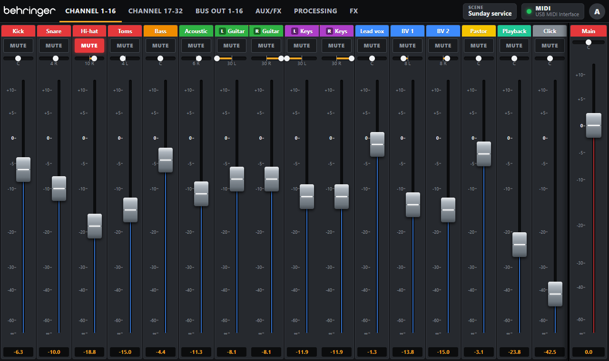
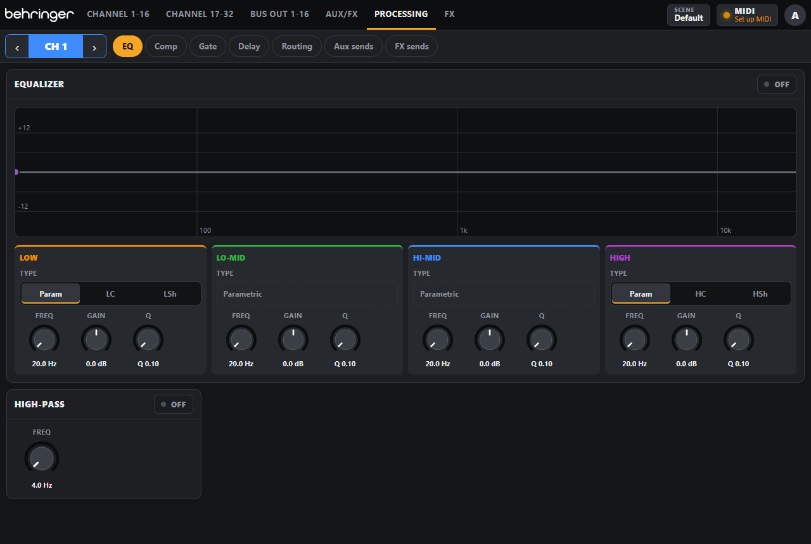
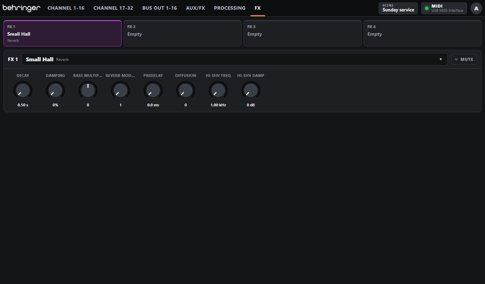
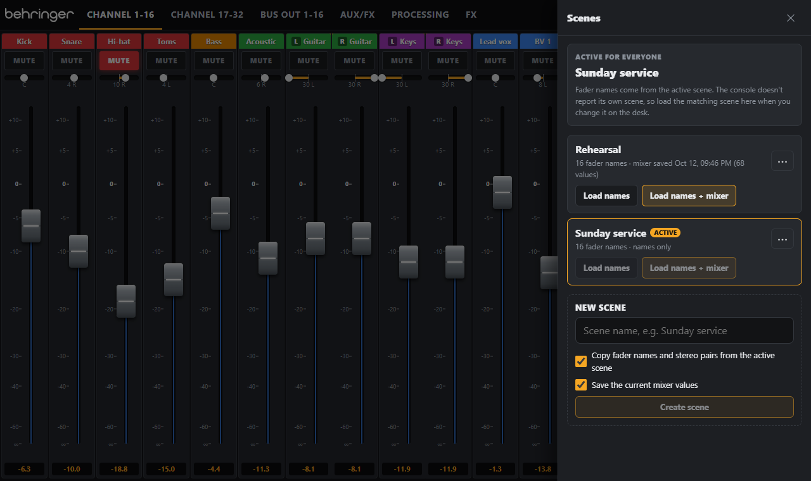
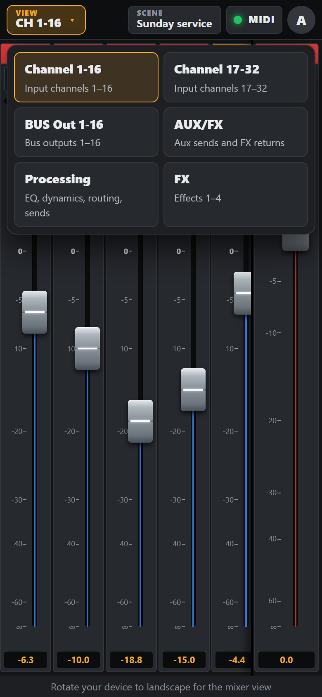

# DDX3216 GUI

A **web-based remote control** for the **Behringer DDX3216 digital mixer**. Run it on a Raspberry Pi
connected to the desk's MIDI ports and control the mixer from any phone, tablet or computer on the
same network.



The UI is built for touch: faders, rotary knobs, an EQ graph, scenes and fader names that update
live on every connected device.

The project builds on the reverse-engineering and documentation work in
👉 **https://github.com/wherget/ddx3216http**

> 🤖 **Version 2.0 was built with [Claude](https://www.anthropic.com/claude)**, Anthropic's AI
> assistant, through [Claude Code](https://claude.com/claude-code). See
> [Built with Claude](#built-with-claude).

---

## Features

### Mixer

- 🎚 **Touch-friendly faders**: they move relative to where you grab them and never jump to the
  finger. They use a console-style dB taper, and a double tap toggles 0 dB.
- 🎛 **Pan / balance bars** and **mute** on every strip; the Main strip stays pinned on the right.
- 📱 **Works on phones**: strips scroll sideways, and a labelled view menu replaces the tabs on
  small screens.
- 🏷 **Fader names and colours**: tap a strip name to rename it. The change appears live on every
  device.

### Processing and FX

- 🎛 **Rotary knobs** for every parameter: drag up or down, double tap to reset.
- 📈 **EQ** with a live frequency-response graph. Bands run Low → High; Low has Param/LC/LSh, High
  has Param/HC/HSh, and the mids are parametric.
- 🗜 **Compressor and gate** with transfer-curve graphs, plus **delay**, **routing** (main, bus
  pairs, bus send) and **aux/FX sends**.
- ✨ **FX 1–4**: an effect picker grouped by category, with a knob for each parameter and return mute.

### Scenes and users

- 🎬 **Scenes**: one active scene for everyone. A scene holds the fader names and, optionally, a
  snapshot of the mixer values. Load **names only**, or **names + mixer**, which sends the saved
  values to the console.
- 👤 **Users and roles**: **Admin** (everything, including users), **Operator** (mixer, MIDI,
  scenes, names) and **Viewer** (read-only). The first visit creates the admin account.

### Connection

- 🔁 **Two-way SysEx**: changes made on the desk show up in every browser, and changes from any
  browser go to the desk.
- 🔌 **USB MIDI plug/unplug is detected instantly** (ALSA announcements). The saved ports reconnect
  automatically, also after a reboot.
- 💾 **Mixer values survive restarts** (stored in SQLite).

<p>
  
  
</p>
<p>
  
  
</p>

---

## How it works

```
 Browser (React)  ──WebSocket JSON──►  ASP.NET Core 8 server  ──SysEx──►  ALSA sequencer ──► USB MIDI ──► DDX3216
  phones/tablets  ◄── live changes ──   (Raspberry Pi)          ◄─SysEx──   (libasound)    ◄──          ◄──
                                         │
                                         └── SQLite: users, scenes, fader names, last mixer values
```

**Server**
- Every change goes through **one ordered queue**: state store, then MIDI out, then the other
  clients.
- Outgoing MIDI is **coalesced** (only the latest value per parameter waits to be sent), **batched**
  (up to 23 changes per SysEx) and **paced** to the MIDI DIN bandwidth.
- Each WebSocket client has its own send queue, so one slow phone can't stall the others.
- Clients get a full **snapshot** when they connect, then live `changes`, `status` and `scene`
  messages; ping/pong detects dead connections.
- **MIDI uses the ALSA sequencer directly** (P/Invoke to `libasound.so.2`), with no RtMidi
  dependency. On non-Linux systems the server runs without MIDI, which is handy for UI
  development.

---

## Tech stack

| Part | Technology |
| --- | --- |
| Client | React 19, Redux Toolkit + RTK Query, Vite, Bootstrap 5 |
| Server | ASP.NET Core 8, WebSockets, cookie authentication |
| MIDI | ALSA sequencer via P/Invoke (`libasound.so.2`) |
| Storage | SQLite with EF Core 8 (migrations applied at startup) |
| Target | Raspberry Pi (linux-arm64), behind nginx |

---

## Development

Prerequisites: **.NET 8 SDK**, **Node.js 18+**.

```bash
# server (MIDI is only available on Linux; elsewhere it runs without MIDI)
cd DDX3216MidiControl.Server
dotnet run --urls http://localhost:5104

# client (proxies /api and /ws to the server)
cd ddx3216midicontrol.client
npm install
npm run dev            # https://localhost:56578
```

To develop the UI against a server that's already running (e.g. the Pi), set
`ASPNETCORE_URLS=http://<pi-address>` before `npm run dev`.

| Command | Description |
| --- | --- |
| `npm run dev` | Client dev server with HMR |
| `npm run build` | Production build of the client |
| `npm run lint` | ESLint |
| `npx @rtk-query/codegen-openapi src/router/apis/openapi-config.ts` | Regenerate the API client (server running on port 5104) |
| `dotnet ef migrations add <Name> --output-dir Data/Migrations` | New database migration (server folder) |

---

## Deploy to a Raspberry Pi

### 1. Publish (on your PC)

```powershell
cd DDX3216MidiControl.Server
dotnet publish -c Release -p:PublishProfile=FolderProfile -o bin/Release/net8.0/publish
```

This produces a **self-contained single file** for `linux-arm64`, so the Pi doesn't need .NET
installed. The web client is in `wwwroot`, and SQLite is bundled.

### 2. Copy and install

```powershell
ssh pi@raspberrypi "rm -rf ~/ddx3216-new && mkdir ~/ddx3216-new"
scp -r .\bin\Release\net8.0\publish\* pi@raspberrypi:~/ddx3216-new/
```

```bash
# on the Pi
sudo systemctl stop ddx3216
rm -rf ~/ddx3216/wwwroot
cp -r ~/ddx3216-new/. ~/ddx3216/
chmod +x ~/ddx3216/DDX3216MidiControl.Server      # scp drops the execute bit
sudo usermod -aG audio $USER                      # access to /dev/snd/seq
sudo systemctl start ddx3216
```

Never delete `~/ddx3216/App_Data`: it holds the database (users, scenes, names), the login keys
and the MIDI settings. Back it up before updating:
`cp -r ~/ddx3216/App_Data ~/ddx3216-backup-$(date +%Y%m%d)`.

### 3. systemd service (`/etc/systemd/system/ddx3216.service`)

```ini
[Unit]
Description=DDX3216 Remote
After=network.target sound.target

[Service]
User=pi
SupplementaryGroups=audio
WorkingDirectory=/home/pi/ddx3216
ExecStart=/home/pi/ddx3216/DDX3216MidiControl.Server
Environment=ASPNETCORE_URLS=http://127.0.0.1:5000
Environment=ASPNETCORE_ENVIRONMENT=Production
Restart=always
RestartSec=5

[Install]
WantedBy=multi-user.target
```

### 4. nginx in front (port 80)

```nginx
location / {
    proxy_pass http://127.0.0.1:5000;
    proxy_http_version 1.1;
    proxy_set_header Upgrade $http_upgrade;
    proxy_set_header Connection "upgrade";
    proxy_set_header Host $host;                  # required by the WebSocket Origin check
    proxy_set_header X-Forwarded-For $proxy_add_x_forwarded_for;
    proxy_set_header X-Forwarded-Proto $scheme;
    proxy_read_timeout 1h;
}
```

### 5. First start

- `journalctl -u ddx3216 -f` should show `ALSA sequencer ready` and the database path.
- Open `http://<pi-address>/` and **create the admin account**.
- In the **MIDI** panel, select your USB MIDI interface as output and input, and set the MIDI
  channel to match the desk.

---

## Configuration (`appsettings.json` or environment variables)

| Setting | Default | Description |
| --- | --- | --- |
| `DataDirectory` | `./App_Data` | Database, login keys, MIDI settings |
| `Database:Path` | `<DataDirectory>/ddx3216.db` | SQLite file |
| `Midi:FilterIncomingChannel` | `true` | Ignore SysEx for other MIDI channels/devices |
| `Midi:MaxBytesPerSecond` | `3000` | MIDI output pacing (DIN ≈ 3125 B/s) |
| `Midi:PollSeconds` | `10` | Fallback port check (hot-plug is event-driven) |
| `WebSocket:CheckOrigin` | `true` | Only accept pages served by this host |
| `WebSocket:AllowedOrigins` | `[]` | Extra allowed origins |
| `WebSocket:IdleTimeoutSeconds` | `30` | Drop clients that stop answering pings |

---

## MIDI / SysEx notes

- Requires a MIDI interface that supports **SysEx**, connected to the desk's MIDI in and out.
- The desk's MIDI channel must match the one selected in the app.
- The live SysEx protocol only carries **parameter changes**: the desk doesn't report which scene
  it's on, so scenes are managed by the app.
- Two corrections to the published SysEx documentation, **confirmed on the desk** and implemented
  in the app:
  - The EQ band order is inverted: **band 1 = High** (Param/HC/HSh), **band 4 = Low**
    (Param/LC/LSh), and the mid bands have no filter type.
  - **Main** uses the document's *Master* parameter numbers (EQ band 3 = 32–34, band 4 = 36–39,
    compressor without key source, fader pre/post compressor = 48).
- Designed for **local studio / LAN use**.

---

## What's new in 2.0

- **New mixer UI**: pointer-based faders that work on phones (no more rotated range inputs),
  redesigned channel strips and a pinned Main strip.
- **Processing and FX redesign**: knobs, EQ and dynamics graphs, a categorised FX picker.
- **MIDI setup panel**: port lists, channel grid, live status, unplugged/loopback warnings.
- **Users, roles and login**; **scenes** with fader names and mixer snapshots.
- **Server rewrite**: ordered change pipeline, per-client queues, typed WebSocket protocol with
  snapshot and ping/pong, coalesced and paced MIDI output, saved MIDI ports, persistent mixer
  values.
- **ALSA sequencer backend** replaces RtMidi, with instant USB hot-plug.
- **Many fixes**, including:
  - lost/out-of-order broadcasts and frozen clients,
  - SysEx batches over 23 changes,
  - out-of-range values wrapping onto other channels,
  - ports leaking on reselect,
  - the Main channel id in processing,
  - duplicated processing parameters,
  - bus pan formatting,
  - EQ band order and Main parameter numbers.

---

## Built with Claude

The 2.0 work on the `feature/mobile-fader-2_0` branch was developed with
**[Claude](https://www.anthropic.com/claude)** (Anthropic) in **Claude Code**, working with the
project owner:

- **Analysis:** reviewing the existing client and server and finding bugs.
- **Implementation:** the UI redesign, the server rework, the ALSA backend, authentication,
  scenes and database migrations.
- **Testing:** end-to-end tests (WebSocket stress tests, auth and scene API tests, browser tests
  on desktop and phone sizes) and screenshot reviews.
- **Desk knowledge:** the decisions about the hardware (EQ band order, Master parameters,
  deployment) were made and verified on the real DDX3216 by the project owner.

Commits made with Claude carry a `Co-Authored-By: Claude` trailer.

---

## Acknowledgements

- **https://github.com/wherget/ddx3216http**: the DDX3216 SysEx documentation and experiments
  this project is based on.

---

## License

MIT License — see [LICENSE](./LICENSE.txt).
